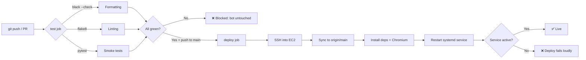
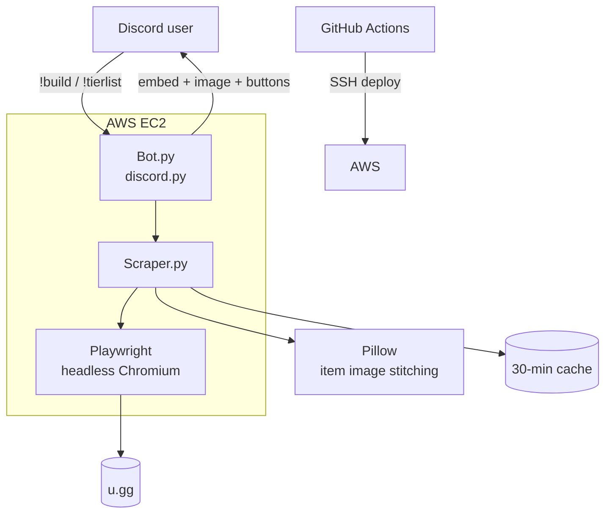

<div align="center">

# League of Legends Discord Bot

**Type a command. Get a full champion build in seconds.**
Live data scraped from u.gg, delivered as rich Discord embeds, and shipped to AWS by an automated CI/CD pipeline.


</div>

---

## The bot

```
!build Katarina-mid        →  rank, win rate, runes, summoners, skill order,
                           counters, and a rendered item-build image
!tierlist top            →  the full jungle tier list, scraped live
```

| | |
|---|---|
| 🏆 **Full builds** | Rank, win rate, summoner spells, complete rune page with shards, skill priority, and toughest matchups |
| 🖼️ **Item images** | Starting, core, and situational items rendered into a single image, built on the fly |
| 🔀 **Alternate builds** | One-click buttons beneath each build swap to other build variants without retyping |
| 📊 **Tier lists** | Every role, including rows that only load as you scroll |
| 🛡️ **Safe by design** | Input validation, per-user and per-server cooldowns, and a 30-minute cache so u.gg isn't hammered |

---

## Under the hood

This isn't a thin API wrapper. u.gg has no public API, so every answer is built by driving a real browser and turning a messy page into clean data.

- **Headless Chromium via Playwright.** The pages are JavaScript-rendered, so plain HTTP requests return nothing useful. One shared browser instance is reused across requests, with a fresh isolated context per scrape.
- **Virtualized tier-list scraping.** The tier table only renders rows near the viewport. The scraper scrolls in steps, de-duplicates by rank, and stops when no new rows appear.
- **Rebuilding item icons from CSS sprites.** Items are served as one big sprite sheet positioned with CSS. The bot parses each element's `background-position` and `scale`, crops the exact tile with Pillow, and stitches the groups into one labeled image.
- **Concurrent fetching.** The build and its alternate variants are fetched together with `asyncio.gather`, so the user waits for the slower request, not the sum of both.
- **Graceful shutdown.** The bot overrides `close()` to shut down Chromium and Playwright, so each deploy restart leaves no orphaned browser processes eating memory.
- **Faster, cheaper scraping.** Images, fonts, and stylesheets are blocked at the network layer, since only the DOM is needed.

---

## CI/CD pipeline

Every change goes through the same automated path. Nothing reaches the live bot unless it passes.



**Quality gates**

| Gate | Tool | What it prevents |
|---|---|---|
| Formatting | Black | Style drift and noisy diffs |
| Linting | flake8 | Unused imports, bare `except`, undefined names |
| Tests | pytest | Broken imports shipping to production |
| PR isolation | Branch rules in the workflow | Pull requests run tests but never deploy |
| Post-deploy check | `systemctl is-active` | A crashed bot being reported as a successful deploy |

**Deployment design**

- **Triggered only by merges to `main`**, after the test job passes (`needs: test`).
- **Deterministic server state.** The deploy runs `git fetch` and `git reset --hard origin/main`, so the server always matches GitHub exactly and local drift can't block a release.
- **Always-on process management.** The bot runs as a `systemd` service with `Restart=always`, so it recovers from crashes and survives reboots.
- **Secrets stay out of the repo.** The Discord token lives in a server-side `.env`, and SSH credentials live in GitHub Actions secrets.

---

## Real problems solved along the way

Building this surfaced the kind of issues that only appear when you actually deploy:
---

## Architecture



## Tech stack

| Layer | Tools |
|---|---|
| Bot | discord.py, python-dotenv |
| Scraping | Playwright, BeautifulSoup, httpx |
| Data and imaging | pandas, tabulate, Pillow |
| Infrastructure | AWS EC2 (Amazon Linux), systemd |
| Automation | GitHub Actions, Black, flake8, pytest |

---

## Run it yourself


---

## Roadmap

- [ ] Unit tests for scraping helpers using saved HTML fixtures
- [ ] Containerize with Docker and deploy via ECR
- [ ] Replace SSH deploys with AWS SSM and GitHub OIDC (no open port 22)
- [ ] Slash commands with autocomplete for champion names
- [ ] Alerts when the scraper's selectors stop matching

---

<sub>Not affiliated with or endorsed by Riot Games or u.gg. League of Legends is a trademark of Riot Games, Inc.</sub>

